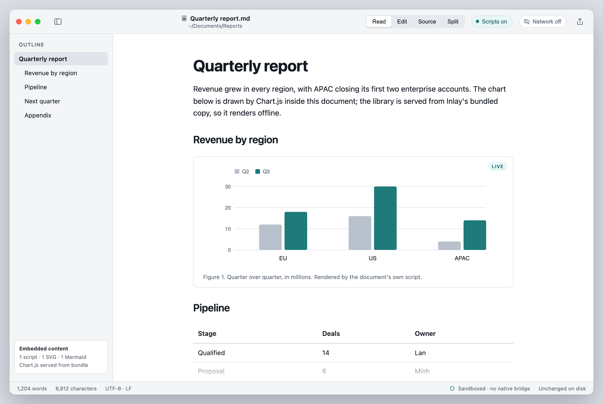
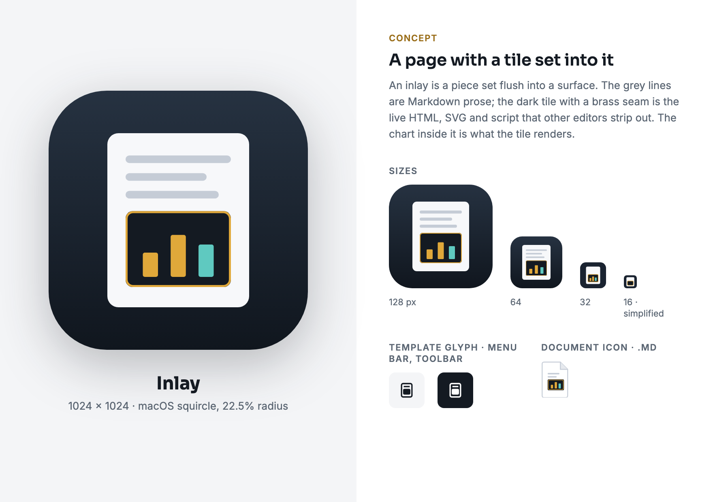
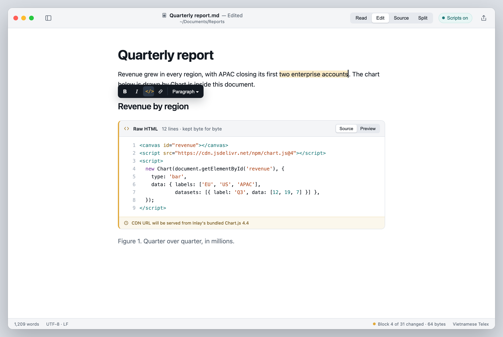
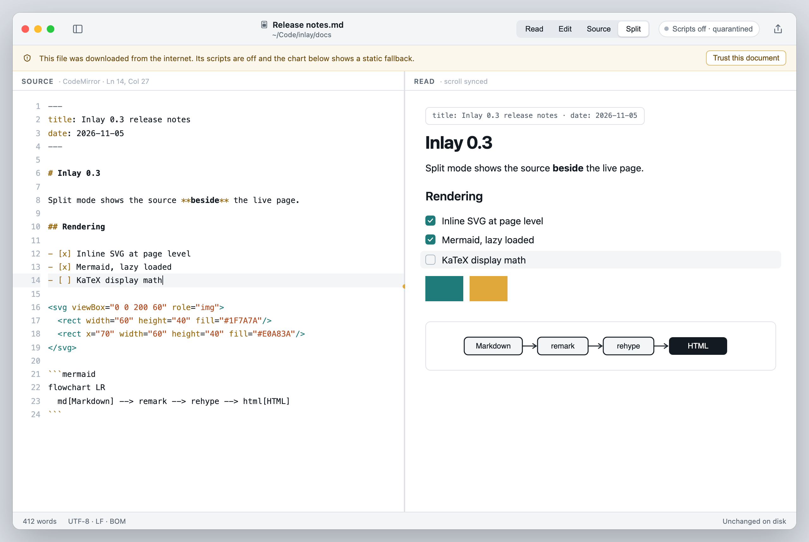
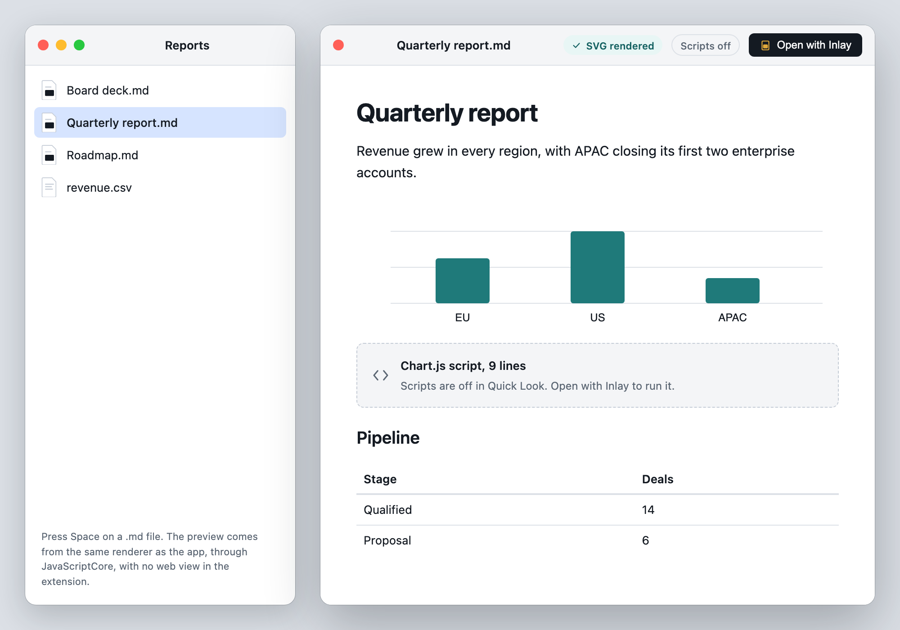
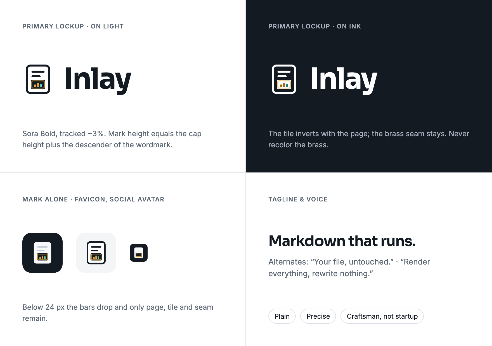
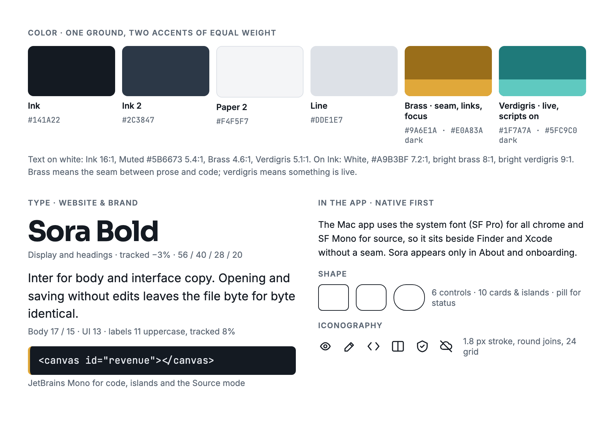
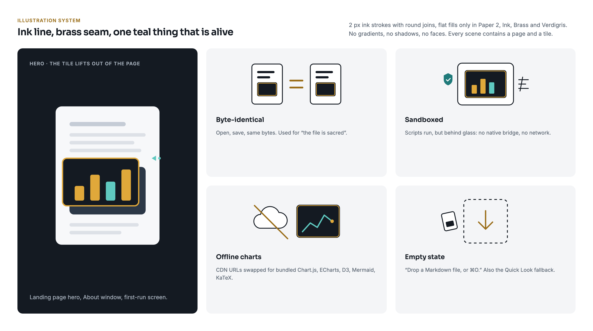
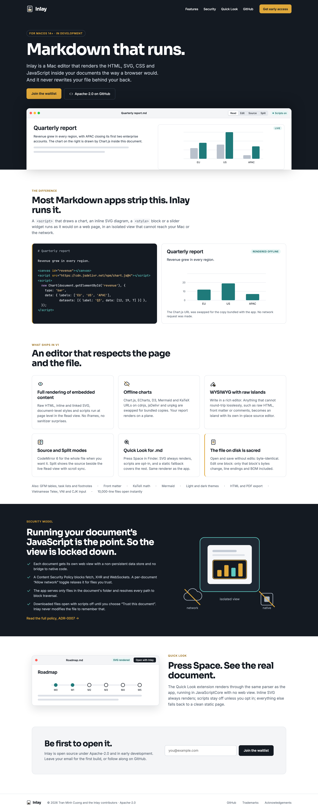

# Inlay

**A Markdown editor for macOS that renders the HTML, SVG, CSS and JavaScript inside your documents the way a browser would.**

[](https://github.com/inlay-md/Inlay/actions/workflows/ci.yml)
[](LICENSE)


> [!WARNING]
> Inlay is in early development and there are no releases yet. The Read view, Source and Split modes and the WYSIWYG editor are built and on `main`. A review in November 2026 found defects that are being fixed before the first beta (see [Status](#status)). Do not use a build from source on files you have no copy of.

<p align="center">
  
  <br>
  <sub>Design mockup of the Read view. The app does not look like this yet; see <a href="#design">Design</a>.</sub>
</p>

Most Markdown apps strip or sanitize embedded HTML. Inlay does the opposite: a `<script>` that draws a Chart.js chart, an inline `<svg>` diagram, a `<style>` block or a slider widget runs as it would on a web page, in an isolated view with no route to native code. Inlay also never rewrites your file behind your back. Opening and saving without edits leaves the file byte-for-byte identical.

Markdown is no longer only prose. AI tools write reports and plans as `.md` files with diagrams, SVG and HTML in them, and the choice so far has been an editor that shows the raw tags or a browser that runs anything. Inlay is built for that gap: **Markdown that runs**, safely, in a file that stays yours.

````markdown
# Quarterly report

Revenue grew in every region.

<canvas id="revenue"></canvas>
<script src="https://cdn.jsdelivr.net/npm/chart.js@4"></script>
<script>
  new Chart(document.getElementById('revenue'), {
    type: 'bar',
    data: { labels: ['EU', 'US', 'APAC'], datasets: [{ label: 'Q3', data: [12, 19, 7] }] },
  });
</script>
````

Inlay serves known libraries such as Chart.js from copies bundled with the app, so a document like this one renders offline.

## Features

Planned for v1. A box is ticked once the feature is built, tested and merged to `main`. Nothing has been released yet, and ticked features still have open defects listed under [Status](#status).

- [x] **Full rendering of embedded content.** Raw HTML, inline and linked SVG, and document-level `<style>` and `<script>` run at page level in the Read view, with no iframes.
- [x] **Offline charts.** Chart.js, ECharts, D3, Mermaid and KaTeX URLs on cdnjs, jsDelivr and unpkg are swapped for bundled copies.
- [x] **WYSIWYG editing**, built on Milkdown Crepe. Anything that can't be edited losslessly, such as raw HTML, front matter or HTML comments, becomes a *raw island* with its own in-place source editor.
- [x] **Source and Split modes** with CodeMirror 6. Split shows the source next to the live Read view with scroll sync.
- [ ] **Quick Look for `.md` files** in Finder. SVG always renders, scripts are opt-in, and a static fallback is used otherwise.
- [x] **The file on disk is sacred.** Open→save is byte-identical. Editing one block changes only that block's bytes, line endings and BOM included.
- [x] GitHub Flavored Markdown (tables, task lists, footnotes), front matter, KaTeX math, Mermaid diagrams and syntax highlighting.
- [x] Local images relative to the document, and light and dark appearance.
- [ ] Themes, custom CSS, and HTML and PDF export.
- [ ] Correct IME input in WYSIWYG and Source, including Vietnamese Telex/VNI and CJK. Automated composition tests pass; the manual check on a release build is still to do.
- [x] Opening a 10,000-line file feels instant.

Out of scope for v1: sync or cloud storage, plugins, AI features, collaboration, the Mac App Store, and Windows/Linux builds. What is proposed after v1 (an outline and find everywhere, a live preview that does not redraw while you type, slides, an export suite, a folder workspace, and later Windows and Linux through a Tauri shell) is in [`docs/ROADMAP.md`](docs/ROADMAP.md).

## Status

| | |
| --- | --- |
| **Built** | Read view, Source, Split, WYSIWYG with raw islands, byte-exact saving through `NSDocument`, offline libraries, quarantine and trust |
| **Being fixed before the beta** | Edits made after the first autosave may not be saved; deleting a block can merge its neighbours on save; a script in a trusted document can send data out through image URLs and can open the browser without a click. Details and the rest of the list: [`docs/ARCHITECTURE.md`](docs/ARCHITECTURE.md), section 6 |
| **Not built yet** | Quick Look (a spike only), export, print, preferences, find outside Source mode, themes, updates, signed builds |
| **Next** | The hardening milestone (MH), then Quick Look (M4): [`docs/PLAN.md`](docs/PLAN.md) |

## Security model

Running a document's JavaScript is the point of Inlay, so the Read view is locked down:

- Each document gets its own WKWebView with a non-persistent data store and **no script message handlers**. Document scripts have no channel to native code.
- A Content Security Policy is sent as a response header. Inline scripts and the three CDN hosts are allowed, and `connect-src 'none'` blocks `fetch`, XHR and WebSockets. A per-document **Allow network** toggle relaxes this for documents you trust.
- The `mdview://` scheme handler serves only files in the document's folder and resolves every path to block traversal.
- Files downloaded from the internet (with the `com.apple.quarantine` attribute) open with scripts disabled until you choose **Trust this document**. Inlay never modifies the file to record that choice.
- Links open in your default browser, and pop-ups and `file:` navigation are refused.

**Known limits today.** Remote images load by default, so a script can pass data out in an image URL; a script can open your browser at a URL without a click; and the folder a document is served from is its whole parent folder. Closing these is the first security work in the plan (ADR-0044). Until then, treat "isolated" as "no access to native code", not as "no way out".

The full policy is in [ADR-0007](docs/DECISIONS.md). To report a vulnerability, see [`SECURITY.md`](SECURITY.md).

## Architecture

Inlay is a thin native shell (Swift, AppKit, `NSDocument`) around a TypeScript web core running in WKWebViews. One Markdown parser, unified/remark, serves every surface, so the Read view, the editor, Quick Look and export all agree.

```
packages/md-render     unified/remark → rehype → HTML; browser ESM build + JavaScriptCore IIFE
packages/editor        document model, CodeMirror Source mode, Milkdown Crepe + raw islands
packages/read-view     the Read view page and runtime
packages/host-api      the Host interface between web and native, plus a MockHost for the browser
packages/settings-ui   settings page                                                         (planned)
apps/macos             XcodeGen project: Inlay app, InlayQuickLook extension, InlayCore Swift package
fixtures/              golden Markdown corpus used by the round-trip and rendering tests
docs/                  brief, product definition, architecture, roadmap, plan, testing, checklists, decisions
```

Every web↔native call goes through the `Host` interface, so the web core also runs in a plain browser against `MockHost`. That lets it be tested in Chromium and WebKit with Playwright, and it keeps a later port to other platforms straightforward. The Quick Look extension renders through the same md-render code, bundled for JavaScriptCore.

## Building from source

Requirements:

- macOS 14 or later, with Xcode 26 or later
- Node.js 22.18 or later, and pnpm 12 (the exact version is pinned in `package.json`)
- [XcodeGen](https://github.com/yonaskolb/XcodeGen) (`brew install xcodegen`)

Install dependencies and the Playwright browsers once:

```bash
pnpm install
```

```bash
pnpm exec playwright install chromium webkit
```

Common commands:

| Command | What it does |
| --- | --- |
| `pnpm dev` | Runs the Read view in your browser against `MockHost`, with a fixture picker at `http://localhost:5173/__inlay/` |
| `pnpm build` | Builds all web bundles and the JavaScriptCore bundle |
| `pnpm test` | Runs unit tests (Vitest) and end-to-end tests (Playwright, Chromium + WebKit) |
| `pnpm check` | Runs lint and format (Biome), typecheck, SPDX headers, license policy and notices freshness |
| `pnpm mac:build` | Builds the web bundles, generates the Xcode project, and builds the app |
| `pnpm mac:test` | Same as `mac:build`, then runs the XCTest suites |

The Xcode project is generated from [`apps/macos/project.yml`](apps/macos/project.yml) and is not checked in. Edit `project.yml` and run `pnpm mac:generate`; never edit the `.pbxproj` by hand.

## Design

The icon, brand and app UI were designed before the app, so each milestone has a target to build toward. The artboards live in [`design/ui`](design/ui) as standalone HTML with screenshots in [`design/ui/png`](design/ui/png); the icon masters and favicons are in [`design/icon`](design/icon). Tasks for applying them are listed per milestone in [`docs/PLAN.md`](docs/PLAN.md).

<table>
  <tr>
    <td align="center" width="50%"><a href="design/ui/png/app-icon.png"></a><br><sub>App icon: a page with a tile set into it</sub></td>
    <td align="center" width="50%"><a href="design/ui/png/app-wysiwyg-raw-island.png"></a><br><sub>WYSIWYG with a raw island</sub></td>
  </tr>
  <tr>
    <td align="center"><a href="design/ui/png/app-split-mode.png"></a><br><sub>Split mode on a quarantined file</sub></td>
    <td align="center"><a href="design/ui/png/quick-look.png"></a><br><sub>Quick Look in Finder</sub></td>
  </tr>
  <tr>
    <td align="center"><a href="design/ui/png/logo.png"></a><br><sub>Logo and wordmark</sub></td>
    <td align="center"><a href="design/ui/png/color-and-type.png"></a><br><sub>Colour and type</sub></td>
  </tr>
  <tr>
    <td align="center"><a href="design/ui/png/illustrations.png"></a><br><sub>Illustration set</sub></td>
    <td align="center"><a href="design/ui/png/website.png"></a><br><sub>inlay.live landing page (<a href="design/ui/website.html">HTML</a>)</sub></td>
  </tr>
</table>

Re-render the screenshots with `pnpm design:render` and the icon set with `pnpm icons`.

## Roadmap

| Milestone | Scope | Status |
| --- | --- | --- |
| **M0** Scaffold | Workspace, Host interface, fixtures, XcodeGen app, CI, licensing | ✅ Merged |
| **M1** Read view | Full rendering, offline libraries, KaTeX, Mermaid, highlighting, isolation, quarantine, file watching | ✅ Merged |
| **M2** Source + Split | CodeMirror Source mode, Split with scroll sync, byte-identical saving through `NSDocument` | ✅ Merged |
| **M3** WYSIWYG | Crepe, raw islands, block-splice saving, mode switching, IME | ✅ Merged; manual IME check outstanding |
| **MH** Hardening | Data-safety and security fixes from the November 2026 review; CI and release groundwork | ⏭️ Next |
| **M4** Quick Look | Rendering tiers 1–3 and shared settings | Planned |
| **M5** Polish and release | HTML/PDF export, print, themes, preferences, Sparkle updates, signed and notarized builds | Planned |

After v1 (proposed, not committed): 1.1 Navigate, 1.2 Produce, 1.3 Trust, 2.0 Workspace, 3.0 Everywhere. See [`docs/ROADMAP.md`](docs/ROADMAP.md).

## Documentation

| Document | What it answers |
| --- | --- |
| [`docs/BRIEF.md`](docs/BRIEF.md) | What v1 must be. The product owner's source of truth |
| [`docs/PRODUCT.md`](docs/PRODUCT.md) | What Inlay is, who it is for, how it behaves |
| [`docs/ARCHITECTURE.md`](docs/ARCHITECTURE.md) | How it is built, and what the last review found |
| [`docs/ROADMAP.md`](docs/ROADMAP.md) | Which release carries what |
| [`docs/PLAN.md`](docs/PLAN.md) | Task lists and their state |
| [`docs/TESTING.md`](docs/TESTING.md) | How it is tested and what is not covered yet |
| [`docs/CHECKLIST.md`](docs/CHECKLIST.md) | Gates before a commit, a push and a release; manual checks |
| [`docs/DECISIONS.md`](docs/DECISIONS.md) | Why things are the way they are |
| [`docs/MONETIZATION.md`](docs/MONETIZATION.md) | How the project could sustain itself (a proposal) |
| [`docs/HANDOVER.md`](docs/HANDOVER.md) | Where work stands, for whoever picks it up |

## Contributing

Contributions are welcome. Read [`CONTRIBUTING.md`](CONTRIBUTING.md) first. In short:

- Sign off every commit (`git commit -s`) to certify the [Developer Certificate of Origin](https://developercertificate.org/). CI rejects commits without a sign-off.
- Use [Conventional Commits](https://www.conventionalcommits.org/) and keep changes small. Never commit with failing tests.
- Every source file carries `SPDX-License-Identifier: Apache-2.0`.
- Dependencies in shipped code must be MIT, BSD, Apache-2.0, ISC or Unlicense. CI rejects GPL, AGPL and LGPL dependencies anywhere in the tree.
- Tests and how to add a fixture: [`docs/TESTING.md`](docs/TESTING.md). Security reports: [`SECURITY.md`](SECURITY.md), not a public issue.

## License

Inlay is licensed under the [Apache License, Version 2.0](LICENSE). Copyright © 2026 Tran Minh Cuong and the Inlay contributors. Third-party licenses are listed in [`THIRD_PARTY_NOTICES.md`](THIRD_PARTY_NOTICES.md).

The name "Inlay", its logo and the `live.inlay.*` identifiers are not covered by the license. If you distribute a modified build, give it a different name. See [`TRADEMARKS.md`](TRADEMARKS.md).
